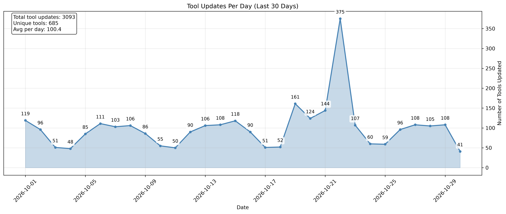

# mise-versions

stores version numbers of common mise plugins

## Static version data

mise reads these static files from `https://mise-versions.jdx.dev/data/`:

- `<tool>.toml`: every known version of one tool, with `created_at` and flags.
- `index.v1.json`: one file covering every tool, with enough entries for `latest`
  and common prefixes such as `22` or `3.12`. See
  [docs/versions-index.md](docs/versions-index.md) for the client contract.
- `github/{owner}/{repo}/releases.json` and `tags.json`: a GitHub repo's whole
  release or tag list, baked at deploy time for the repos clients have asked
  for (others are answered by the Worker at the same URL). See
  [docs/github-versions.md](docs/github-versions.md) for the client contract.

## Tool Update Analysis

This repository tracks tool updates through git history analysis. The chart below shows the daily number of tool updates over the last 30 days.

### Daily Tool Updates (Last 30 Days)



_Timeline showing the number of tools updated each day over the last 30 days_

## Token pool observability

The scheduled Worker records GitHub core-rate-limit snapshots every 15 minutes,
and the authenticated `/admin` dashboard displays them. It shows aggregate
quota headroom, quota burn per hour, token checkout rate, estimated time until
the 1,000-request-per-token reserve, and the latest headroom for each pool token.

Each run checks at most 45 tokens to stay within the Workers Free-plan external
subrequest limit while leaving room for alerts. Larger pools rotate through
batches and are shown as incomplete rather than being classified as critical.

The monitor warns only when the pool is at risk: only one token is available,
10% or more of the checked tokens fail their check (and at least 10 tokens, or
10% of a smaller pool, so a few dead tokens in one early batch don't count),
less than 35% of lendable quota remains, or the pool is within six hours of
reserve. It becomes critical at
zero available tokens, 15% lendable quota, or two hours to reserve. A few
rate-limited, below-reserve or unreachable tokens, or a rotation that has not
yet covered the whole pool, do not warn on their own; the dashboard still
shows them.

Alerts use Resend. `TOKEN_ALERT_TO` and `TOKEN_ALERT_FROM` are non-secret Worker
variables in `wrangler.jsonc`; configure `RESEND_API_KEY` as a Worker secret:

```sh
aube exec wrangler secret put RESEND_API_KEY
```

Alerts are sent on warning/critical transitions, repeated after 12 hours while
unhealthy, and followed by a recovery notification. The deploy workflow syncs
the existing GitHub Actions `RESEND_API_KEY` secret into the Worker.
